* 🧳 Launched May 2022
* 🚪 Release v3.0.0
* 📦Code size 95 KB


## Short description
Add your own learned words to the app to reinforce your knowledge with a daily quiz. 

Lessons are formed by priority words. The more often the user uses the bot, the more productive it works. 

Checks such as card-word, word-card - with a regular approach, they allow you to very effectively consolidate the learned words, especially when the user chooses his own examples with words.

Track your progress. Train every day. Edit words. Build your code on top of the API.

You can check how the user part of the telegram [bot](https://t.me/teleword_learning_bot) (@teleword_learning_bot) works.

---

## Table of contents

* [User guide](#user-guide)
  * [First steps](#fs)
  * [Adding new words](#adw)
  * [Lesson](#lesson)
  * [Statistic](#stat)
  * [Get, change, delete](#gcd)
  * [API](#api)
* [Installation guide](#installation)
  * [Docker compose](#docker-compose)
  * [Without Docker](#local)
* [Contact](#contact)

---
---

## <a name="user-guide"></a> User guide
A quick overview of the main functionality
### <a name="fs"></a> First steps
First of all, you enter the bot using the ```/start``` command

And ```/help``` command to get to the main menu

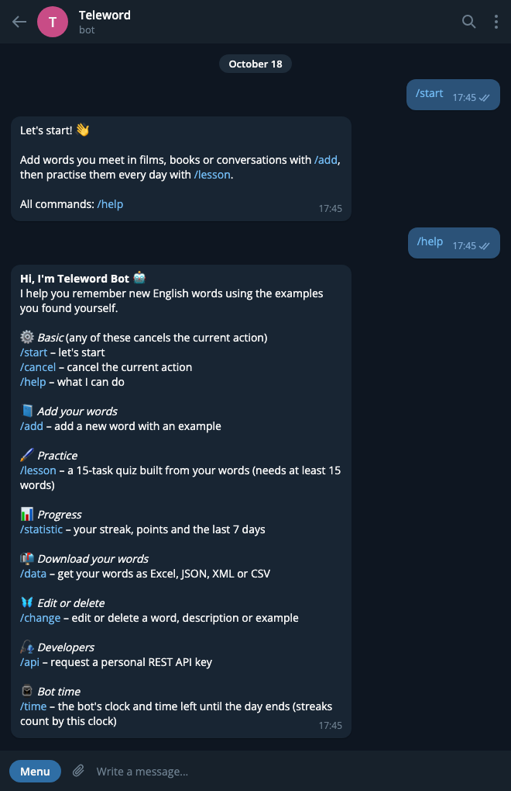

> :suspect: The user is verified; the data is entered into the table
> 
>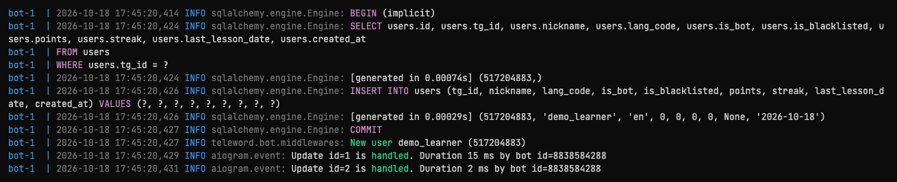
>
>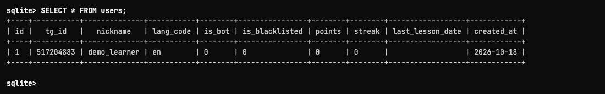

### <a name="adw"></a> Adding new words
Now it's time to add new data, this is how it usually looks for me

I open the series with subtitles, a dictionary (for me, it's just a browser) and a Teleword

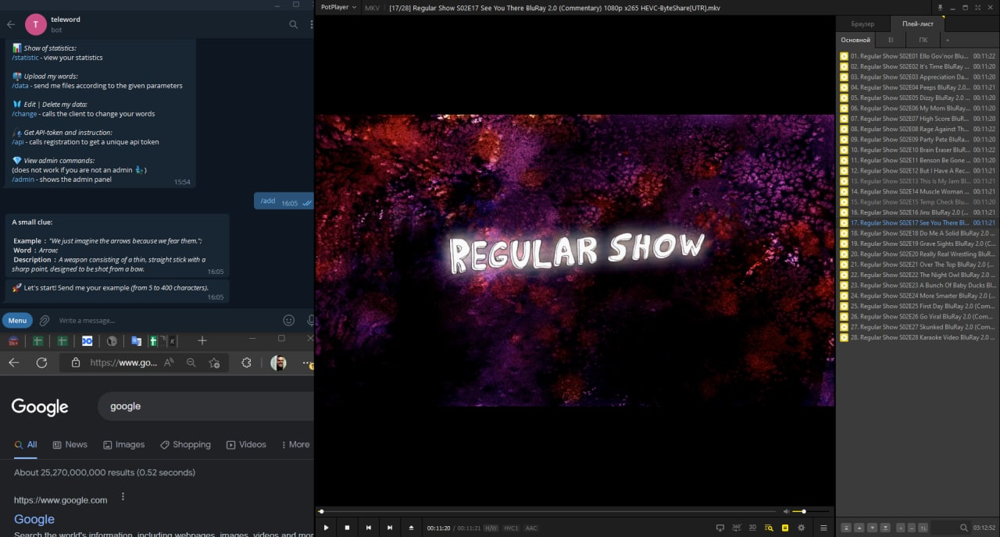

I watch a series until I stumble upon an unfamiliar word

I write down a remark with this word and look it up in the dictionary

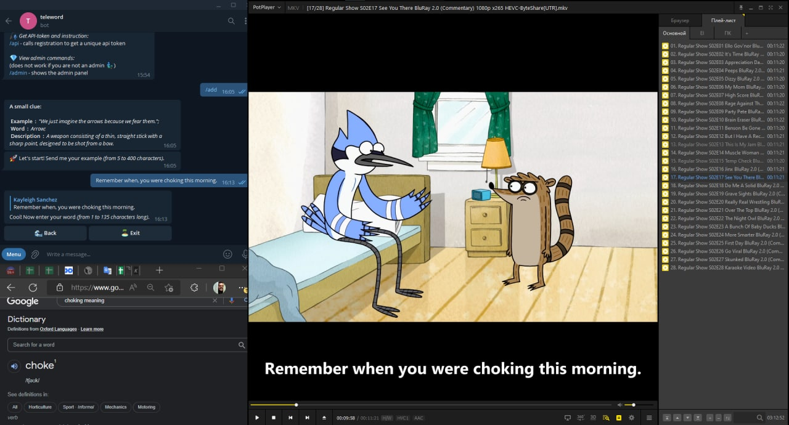

I copy the description and wait for a successful addition

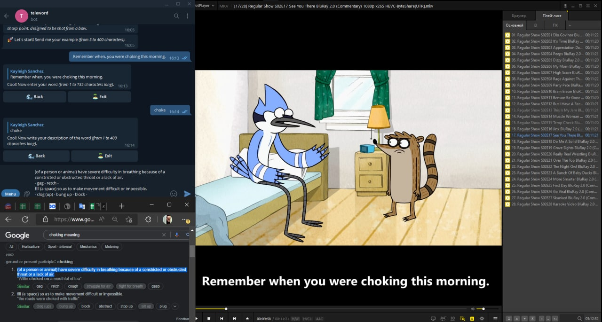

Great, I click ```continue``` and continue to enjoy the series only a level smarter than I was 30 seconds ago

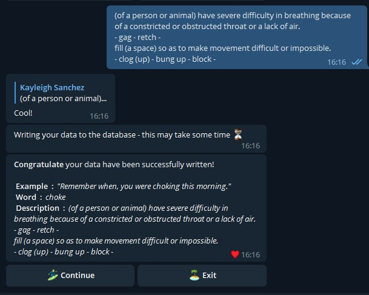

> :hurtrealbad: Under the hood:
>- the data is checked for correctness
>- the part of speech of the word is pulled up for more effective testing
>- rating is being prepared
> 
>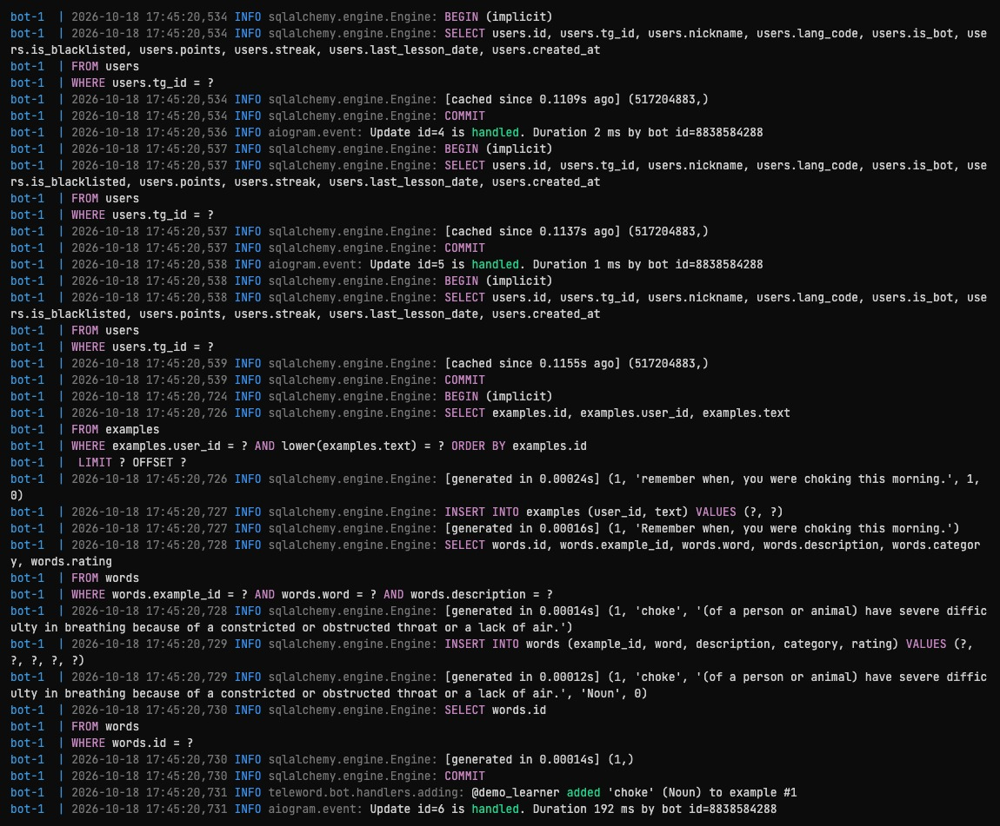
> 
>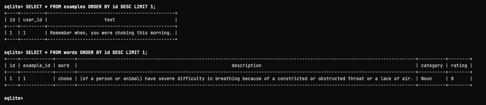

### <a name="lesson"></a> Lesson
You have added more than 15 initial words (I recommend at least 30-40) - now you can start(```/lesson```) filling words 
with tests 

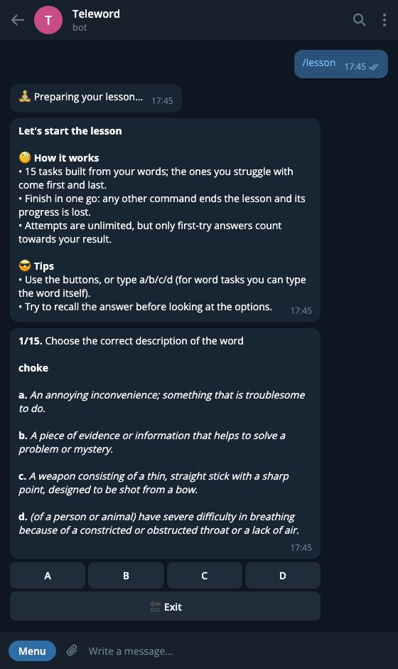

This is what we remember! Let's read the example again to strengthen our knowledge.

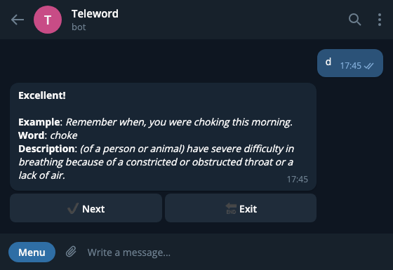

> :godmode: One of the hardest parts of the backend is hidden behind the lesson formations.
> 
> It is after the lesson that all user statistics are collected - his mistakes, successes, attendance, the rating of words changes. 
> 
> The occupation itself is formed by repeated enumeration with a bit of randomness.
> 
> You can see Python code in function ```services.lessons.build_lesson()```
> 
> The logic for checking the correctness of the answer is enclosed in two coroutines:
> - one of them checks if the lesson is finished, takes the next task from the lesson state in redis and displays it to the user ```bot.handlers.lessons.next_task```
> - the other one catches the user's response (a button or a typed letter), checks it and updates the lesson state ```bot.handlers.lessons.check_answer```
> 
> At the end, ratings, daily statistics, points and the streak are saved in one transaction ```services.lessons.finish_lesson()```
 
### <a name="stat"></a> Statistic
Who doesn't like to look at statistics? Make a smart face and click ```/statistic```

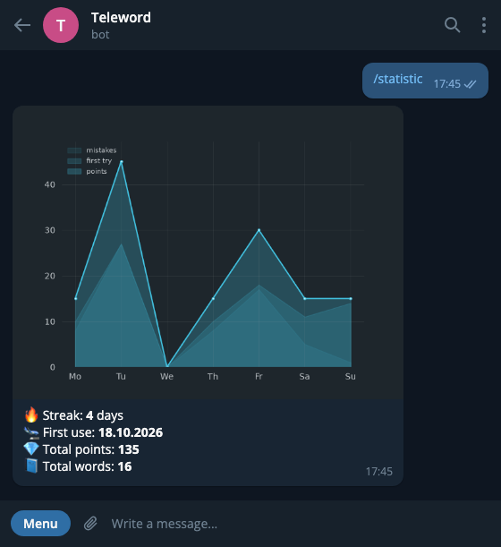

> :rage1: We climb into the database, count the number of words ```services.vocabulary.count_words()```, and the user table gives the total number of points and the streak - days in a row with at least one lesson ```services.streak.current_streak()```. 
>
> We transfer data by day from the statistics table to plotting through matplotlib, in a worker thread, so the bot keeps answering other users meanwhile
> 
> ```services.stats.recent_stats()``` -> ```bot.charts.render_stats_chart()``` -> ```bot.handlers.statistic.statistic_cmd()```
> 
> 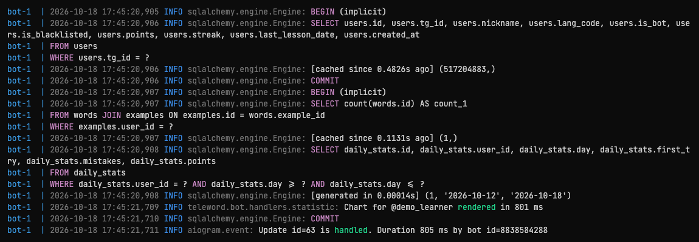
> 

### <a name="gcd"></a> Get, change, delete
We do not hide anything from users, if they need words with the right data type - hold on command ```/data```

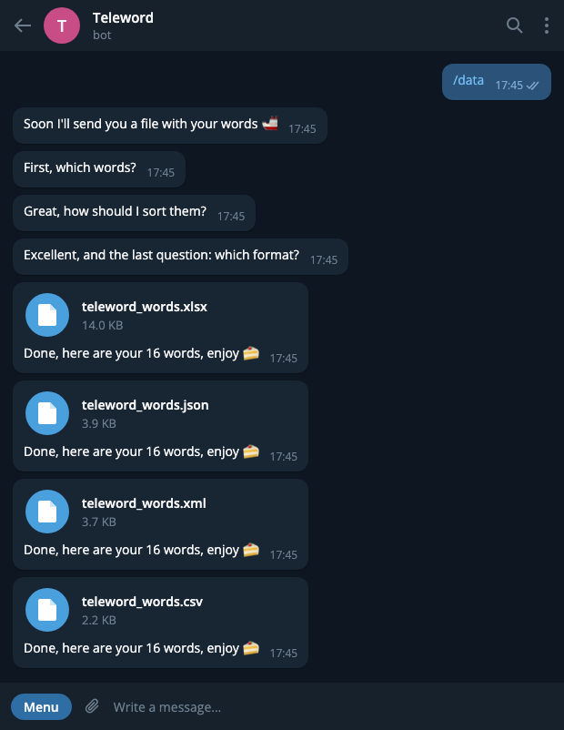

If you are a regular user - my advice to you - enjoy a beautiful ```Excel``` file :sunglasses:

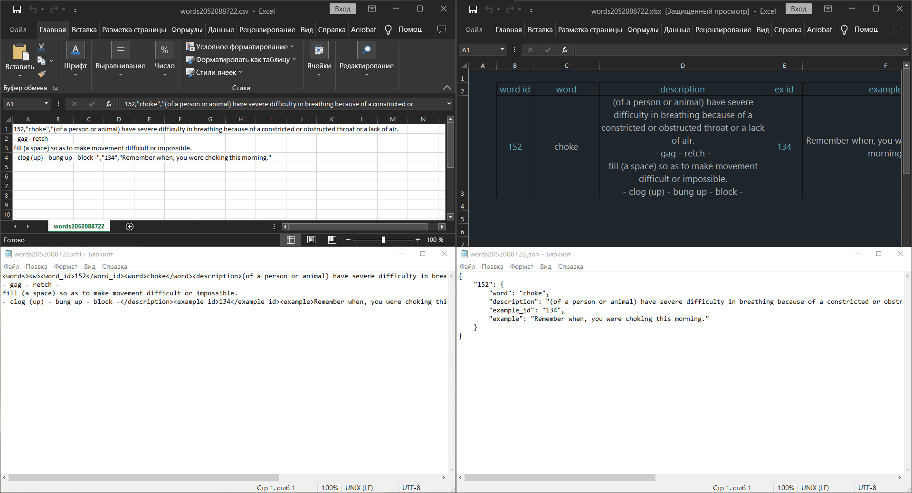

The logic is simple, choose what and with what you want to do and do it

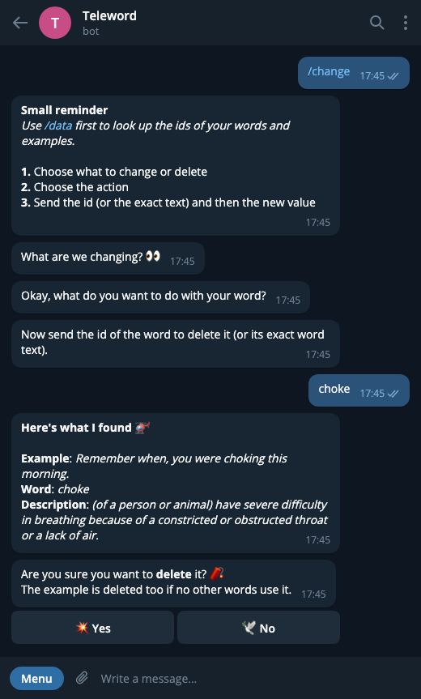

> :suspect: The logic is simple - give the user the opportunity to edit their data on the sql data ids.
> 
> By revalidating the input, checking permissions, and running a cascading deletion of words when trying to delete an example.

### <a name="api"></a> API

Or maybe we want to develop something of our own on the Teleword api? Then let's kindly distract our good old friend admin from swimming in the Mediterranean Sea and drinking cocktails

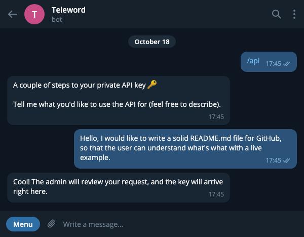

As soon as the admin approves the request, the key arrives right in the chat, together with detailed instructions for use

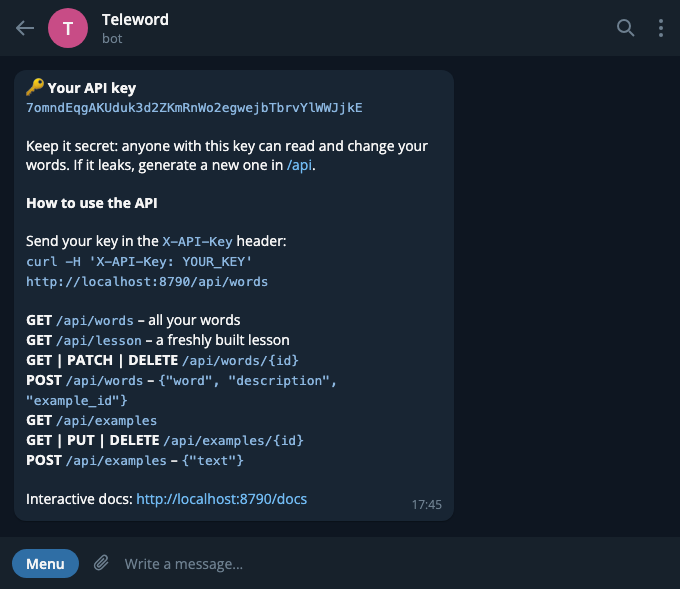

> :shipit: All methods of the restful interface are implemented with FastAPI in ```teleword/api/app.py```, interactive documentation is at ```/docs```. The key is sent in the ```X-API-Key``` header and is stored only as a hash.
> 
> The administrator still looks at every request personally, but now it is one tap: the key is generated and sent to the user automatically.
> 
> 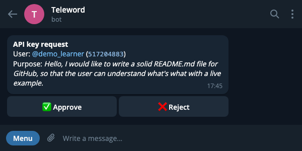
---
---

## <a name="installation"></a> Installation on the server

Let's make sure the linux machine is up-to-date.
```
sudo apt update && sudo apt upgrade -y
```
Installing useful packages
```
sudo apt install git openssh
```
Let's generate ssh keys using the s4lv [ed25519](https://en.wikipedia.org/wiki/EdDSA) method
```
ssh-keygen -t ed25519 
```
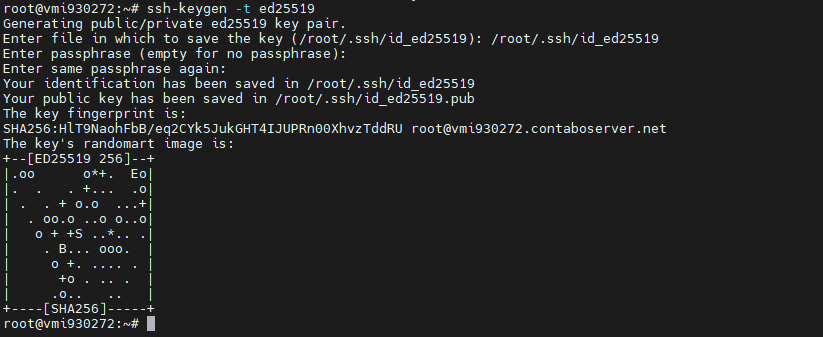

Setting up access to ssh keys
```
cd /root/.ssh/
touch config
```
```
nano config
```
```
Host <SSH NAME>
 HostName github.com
 IdentityFile ~/.ssh/<KEY>
 IdentitiesOnly yes
```
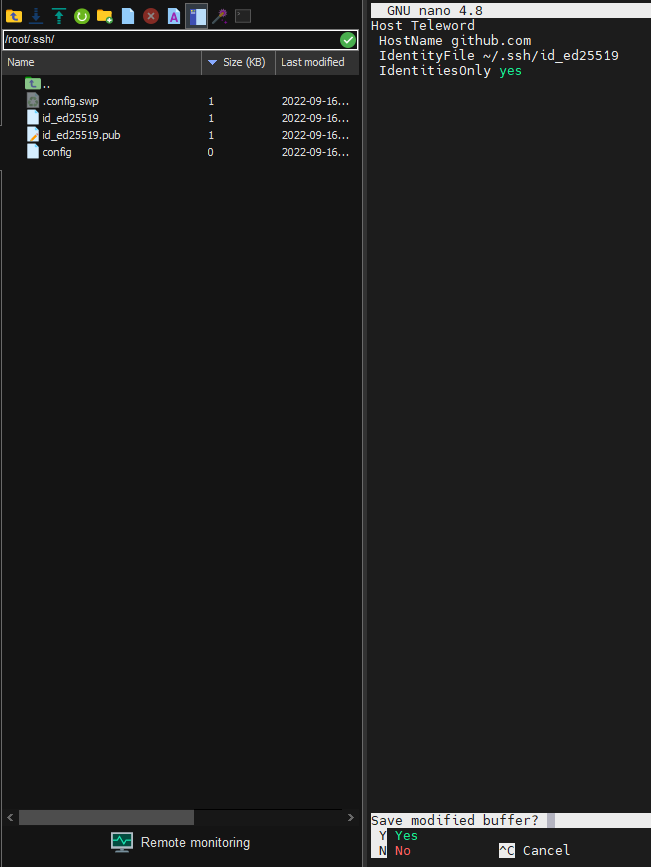


Copy the public key and transfer it to GitHub
```
 cat <KEY>.pub
```
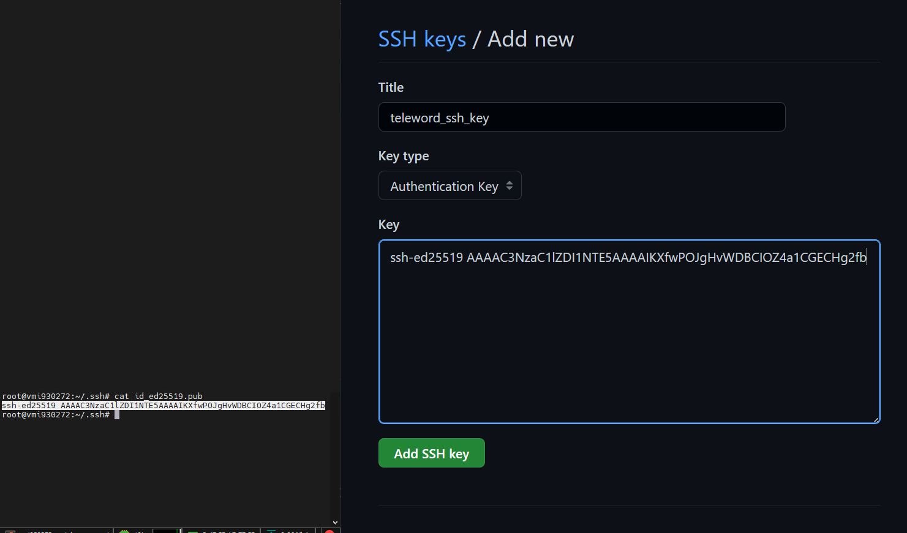

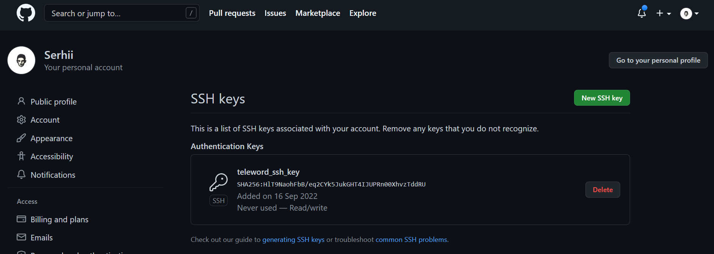

```
cd #
git clone git@<SSH NAME>:vinter-man/teleword.git
```
> yes

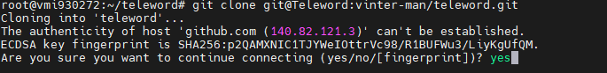


Create the config from the example and fill in the bot token and your Telegram id
```
cd teleword
cp .env.example .env
nano .env
```
> Do not forget to change the config file for yourself.

### <a name="docker-compose"></a> Docker compose
Install [Docker with the compose plugin](https://docs.docker.com/engine/install/ubuntu/)

```
docker compose build --quiet
docker compose up -d
docker compose ps
```
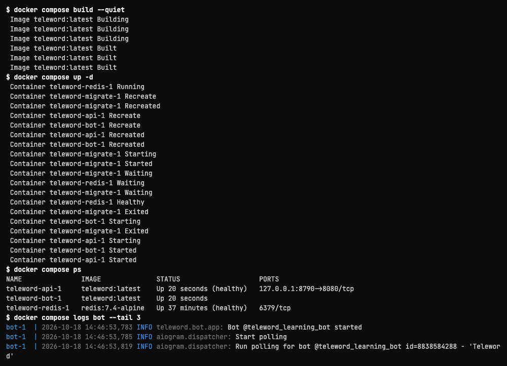

The stack is self-contained, so it can live on a server next to other projects: its own network and volumes, read-only containers with memory and CPU limits, rotated logs. The bot needs no open ports; the API listens on ```127.0.0.1:8790``` only.

View logs in real time
```
docker compose logs -f bot
```

### <a name="local"></a> Without Docker
Install [uv](https://docs.astral.sh/uv/getting-started/installation/), it brings the right Python version itself
```
uv sync
uv run python -m teleword.db
uv run python -m teleword.bot
uv run uvicorn --factory teleword.api.app:create_app
```
Without ```REDIS_URL``` in ```.env``` the bot keeps conversation state in memory. Run the tests with ```uv run pytest```

---
---


## <a name="contact"></a> Contact

* Telegram - https://t.me/vindemure
* Mail -   serhiivinterman@gmail.com

---
---


---
---


