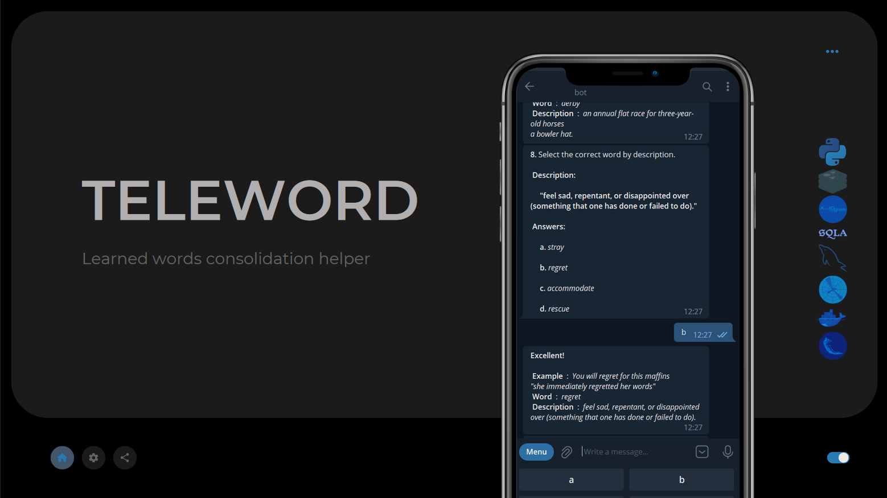
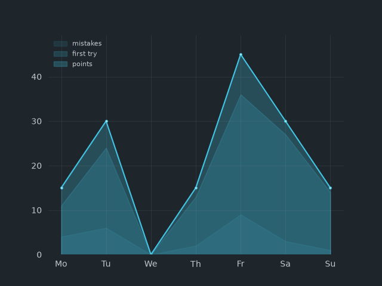
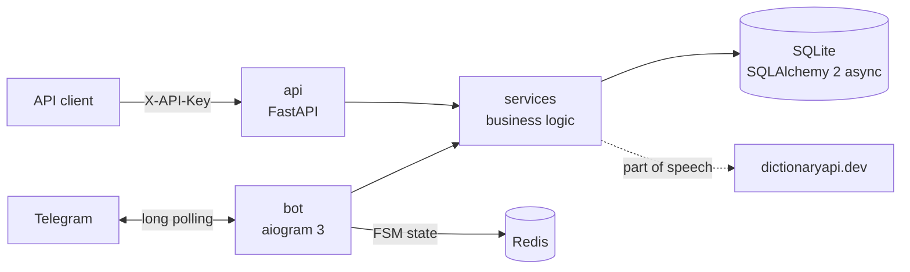

# Teleword



[](https://github.com/vinter-man/teleword/actions/workflows/ci.yml)


**Teleword** is a Telegram bot that helps you actually remember the English words you run into.
You save a word together with the sentence where you found it, and the bot turns your own
examples into a daily 15-question quiz that focuses on the words you keep getting wrong.

Try it: [@teleword_learning_bot](https://t.me/teleword_learning_bot)

## Features

| Command | What it does |
| --- | --- |
| `/add` | Save a word: example sentence → word → description. The part of speech is looked up automatically. |
| `/lesson` | A 15-task quiz. Even tasks: pick the description of a word; odd tasks: pick the word by its description. |
| `/statistic` | Daily streak, points, word count and a chart of the last 7 days. |
| `/data` | Download your words as Excel, JSON, XML or CSV, all words or only the "important" ones. |
| `/change` | Edit or delete a word, a description or a whole example. |
| `/api` | Request a personal key for the REST API (the admin approves it in one tap). |
| `/time` | The bot's clock; streak days are counted by it. |
| `/admin` | Admin only: blacklist, ban/unban, broadcast. |

### How a lesson is built

Every word has a **rating**: it goes up by one for every wrong answer and down by one for the final
correct answer. A lesson takes the 5 highest-rated words (the ones you struggle with), opens with
three of them as "work on mistakes", closes with the other two as the "final boss", and fills the
middle with 10 random words. Wrong options are taken from words with the **same part of speech**
whenever possible, so you can't guess the answer from grammar alone.



## Architecture



* **`teleword/services`**: all business logic (vocabulary, lessons, streaks, export, API keys).
  Plain async functions over an `AsyncSession`; no Telegram or HTTP types inside, so the bot and
  the API share it.
* **`teleword/bot`**: aiogram 3 routers. A middleware opens one DB session per update, registers
  new users on their first message and drops updates from blacklisted users.
* **`teleword/api`**: FastAPI app with OpenAPI docs at `/docs`.
* **`teleword/db`**: SQLAlchemy 2 models: `users`, `examples`, `words`, `daily_stats`, `api_keys`.

## Running it

### Docker (recommended)

```bash
cp .env.example .env        # set BOT_TOKEN and ADMIN_ID
docker compose up -d --build
docker compose logs -f bot
```

The stack is self-contained: its own network and volumes, read-only containers without Linux
capabilities, memory/CPU limits and rotated logs. The bot needs no open ports (long polling); the
API listens on `127.0.0.1:8790` only, so put a reverse proxy in front of it to publish it.

### Locally

```bash
uv sync
cp .env.example .env        # set BOT_TOKEN and ADMIN_ID
uv run python -m teleword.db                                   # create tables
uv run python -m teleword.bot                                  # the bot
uv run uvicorn --factory teleword.api.app:create_app --reload  # the API
```

Without `REDIS_URL` the bot keeps conversation state in memory.

### Configuration

| Variable | Default | Meaning |
| --- | --- | --- |
| `BOT_TOKEN` | required | Token from [@BotFather](https://t.me/BotFather) |
| `ADMIN_ID` | required | Telegram id of the admin (API key approvals, `/admin`) |
| `DATABASE_URL` | `sqlite+aiosqlite:///./data/teleword.db` | Any SQLAlchemy async URL |
| `REDIS_URL` | empty | FSM storage; empty means in-memory |
| `TIMEZONE` | `UTC` | Day boundaries for streaks |
| `API_PUBLIC_URL` | `http://localhost:8080` | Base URL shown in `/api` instructions |
| `DICTIONARY_API_URL` | dictionaryapi.dev | Part-of-speech lookup |

## REST API

Get a key with `/api` in the bot and send it in the `X-API-Key` header.

```bash
curl -H "X-API-Key: $KEY" https://your-host/api/words
curl -H "X-API-Key: $KEY" -H "Content-Type: application/json" \
     -d '{"text": "We just imagine the arrows because we fear them."}' https://your-host/api/examples
curl -H "X-API-Key: $KEY" -H "Content-Type: application/json" \
     -d '{"word": "arrow", "description": "Shot from a bow", "example_id": 1}' https://your-host/api/words
curl -H "X-API-Key: $KEY" https://your-host/api/lesson
```

| Method | Path | |
| --- | --- | --- |
| `GET` | `/api/words` | All your words with their examples |
| `POST` | `/api/words` | Add a word to an existing example |
| `GET` `PATCH` `DELETE` | `/api/words/{id}` | Deleting the last word of an example deletes the example |
| `GET` `POST` | `/api/examples` | |
| `GET` `PUT` `DELETE` | `/api/examples/{id}` | Deleting an example deletes its words |
| `GET` | `/api/lesson` | A freshly built 15-task lesson (`409` with fewer than 15 words) |
| `GET` | `/health` | Liveness probe |

Objects of other users are reported as `404`, so ids cannot be probed. Keys are stored as SHA-256
hashes and can be rotated from the bot.

## Tests

```bash
uv run pytest --cov
```

82 tests, 94% line coverage, no network access:

* **unit**: lesson building, answer parsing, streak rules, export formats;
* **services on a real SQLite database**: ownership isolation, cascades, statistics, API keys;
* **bot end-to-end**: fake Telegram updates go through the real dispatcher, middlewares and
  database, with Bot API calls recorded by a fake session (add a word, a full lesson, export,
  editing, the API key approval, admin commands, error handling);
* **REST API** through an ASGI transport.

CI runs ruff, the tests and a Docker build on every push.

## Version 3: what changed

Teleword started in 2022 as an aiogram 2 + Flask + MySQL project. Version 3 is a full rewrite
that keeps every feature and fixes the things that made it flaky:

* **One shared SQLAlchemy session for the whole app** (async bot plus threaded Flask) caused the
  random `PendingRollbackError`s. Now there is one session per update / request.
* Blocking DB and HTTP calls ran inside the event loop. Everything is async now, and chart
  rendering and file export run in worker threads.
* User text broke Telegram's MarkdownV2 parser. Messages now use HTML with escaping.
* Raw SQL built with `str.format` → ORM queries.
* Flask ran with `debug=True` (remote code execution via the Werkzeug debugger) → FastAPI.
* API keys travelled in the URL path and were stored in plain text → `X-API-Key` header, hashed
  keys, approval and rotation from the bot.
* Edits were silently lower-cased; "most important words" averaged ratings over all users;
  the blacklist was stored but never enforced; starter words referenced a config that wasn't in
  the repository; temporary files leaked on errors; matplotlib figures were never closed.
* Secrets lived in a committed config file → environment variables; the paid Oxford dictionary
  API → the free dictionaryapi.dev.
* A hand-written process supervisor → Docker restart policies and health checks.

## Contact

* Telegram: [@vindemure](https://t.me/vindemure)
* Email: serhiivinterman@gmail.com
